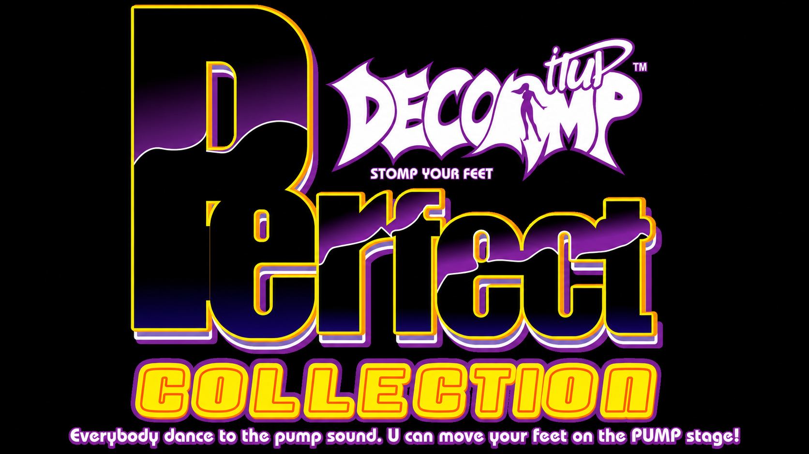

  

**Idiomas:** [Português (BR)](README.md) · [English](README.en.md) · **Español**

# PiuReconstructed — Pump It Up (PIU.EXE, DOS, "Dec 18 2000") recompilado en C

Cómo jugar: haz doble clic en `jogar.bat` (usa la carpeta `..\game`). O: `PiuReconstructed.exe -game <carpeta del juego>`.

## Descargas (Releases)
Los binarios para **Windows (x64)**, **Linux (x64)** y **macOS** los genera GitHub Actions con cada tag `v*` (pestaña *Releases*). Los datos del juego original (`PIU.EXE`, `BGA/`, `STEP/`, `AUDIO/`...) **no** se incluyen: apunta a tu carpeta con `-game <carpeta>` (por defecto: `../game`).
- Linux: necesita `libsdl2-2.0-0` (y un driver OpenGL). macOS: `brew install sdl2`.

## Controles
| | |
|---|---|
| Selección | Arriba/Abajo canción (PgUp/PgDn ±10), Izquierda/Derecha nivel, **Enter** jugar, **1–8** velocidad, **Esc** salir, F11 pantalla completa |
| P1 (5 pads) | `Z` ↙, `Q` ↖, `S` **centro**, `E` ↗, `C` ↘ |
| P2 / Double | Teclado numérico `1` ↙, `7` ↖, `5` **centro**, `9` ↗, `3` ↘ (en fases single el teclado numérico también juega las 5 columnas) |
| Título | `S` (o Enter/Espacio) = START P1 (PRESS CENTER STEP), Num `5` (o Num Enter/Num +) = START P2 |
| Elección de modo | `Z`/`C` (P2 Num 1/3, azules) desplazan la lista; `Q`/`E` (P2 Num 7/9, arriba) seleccionan el elemento izquierdo/derecho y pulsar el mismo otra vez entra (como en el código original); Enter/Espacio = atajo |
| En juego | Esc vuelve a la selección |
| Arcade | **F1** SERVICE (abre el menú de servicio y selecciona), **F2** TEST (mueve), **F3** Coin Clear, **F4** moneda (F5 también), Alt+X sale |

## Estado (Fase 1: fidelidad)
- Fiel (confirmado en el ensamblador): tiempo de 240 Hz, scroll, cambio de BPM, ventanas Perfect/Great/Good/Bad por BPM, reglas de juicio, combo/puntuación/vida, formatos `.NOT`, `.AUD`(MP3), `.PNZ`(PNG), `.DAT`(RES/BGA/SPR/SP2).
- Reconstrucción funcional (el original no fue decompilado por completo): menú de selección, pantalla de resultado/nota, sprites exactos de las flechas, efectos de acierto, notas largas (si existen), modos/opciones de juego, transiciones y pantallas de attract/título.
- Renderizado: OpenGL 1.x (SDL2). Ver docs/ para el mapa de direcciones del PIU.EXE original.

## Compilación
`cmake -S . -B build_msvc -G "Visual Studio 17 2022" -A x64 -DCMAKE_TOOLCHAIN_FILE=C:/vcpkg/scripts/buildsystems/vcpkg.cmake -DVCPKG_TARGET_TRIPLET=x64-windows-static`  
`cmake --build build_msvc --config Release` (genera `piu.exe`; `piu_test.exe` valida todos los archivos).  
Autotest: `piu.exe -game ../game -song 101 -diff 1 -selftest 25 -shot shot.ppm` (autoplay; `-noauto` lo desactiva).

## Flujo de pantallas (Actualización 13) - igual que PIU.EXE
`idle -> logo (BGA/81.DAT, 500 cuadros) -> idle -> intro (BGA/01.DAT, hasta 945 cuadros) -> título (BGA/82.DAT, bucle de 180 cuadros) -> selección`.
Origen: bucle principal `0x20F37` (estado en `DAT_00153710`). Sin crédito el juego se queda en attract; **5 (o F5) = moneda**,
**Enter/Espacio = START P1**, **Num Enter/Num + = START P2**; ~1 s después de empezar va a la selección. ESC vuelve a idle (como el original), Alt+X sale.
Opciones: `-freeplay` (crédito infinito), `-coins N`, `-skip` (directo a la selección).

## Build PC ("Perfect Collection", `pumpy.exe`)
Segundo objetivo `piu_pc` (`PIU_BUILD_PC`), con los datos de la PC (`PUMPY_0416`): `piu_pc.exe -game <carpeta PC>`. Diferencias y direcciones: [docs/PC_DIFF.es.md](docs/PC_DIFF.es.md).
